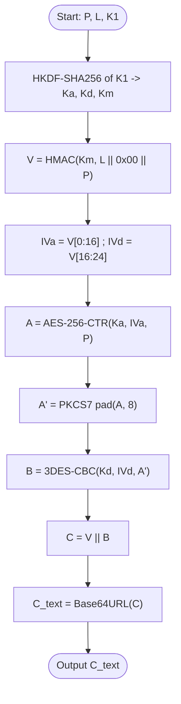
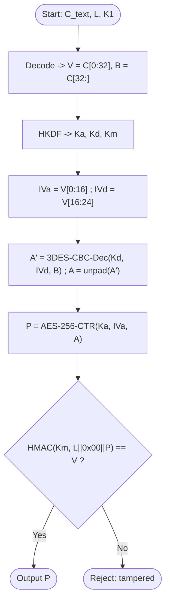
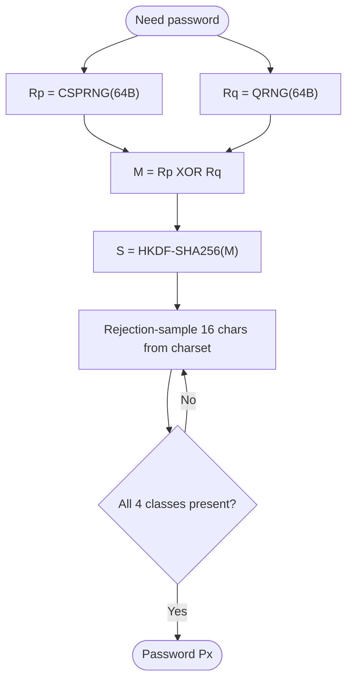
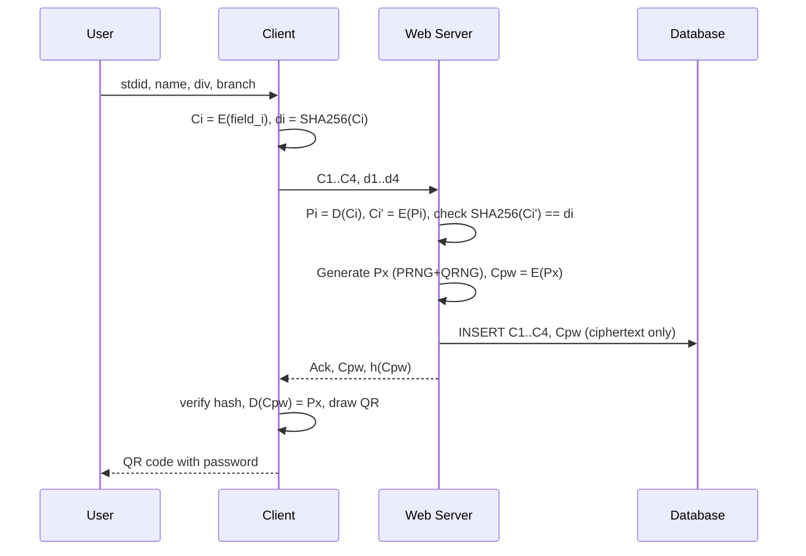
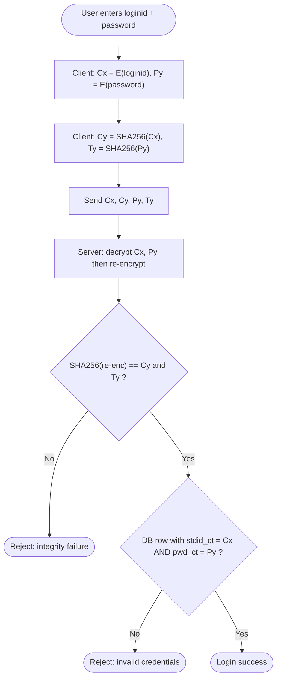

# Experiment 9: Secure Registration and Login (Custom Hybrid Encryption + SHA-256)

**Aim:** Implement our own encryption algorithm and hashing technique to ensure confidentiality and integrity of data over a communication channel.

Status: PLAN, awaiting approval. No implementation has started.

---

## 1. What we are building

A client (web page) and a web server that talk only in encrypted + hashed form.

| Part | Role |
|---|---|
| Client (browser) | Registration form, login form, encrypts fields, hashes ciphertexts, renders the password QR code |
| Web server | Verifies integrity, generates the password (PRNG + QRNG), stores **ciphertext only**, checks logins |
| Database | Stores only encrypted values. **No plaintext, no hashes.** |

Shared secret: one symmetric master key **K1** known to both client and server (as on the whiteboard).

### Proposed stack (please confirm, see Section 9)
- **Node.js + Express** backend, **SQLite** (`better-sqlite3`) database
- **HTML/CSS/JS** frontend, served by Express
- **One shared cipher module** (`hcads.js`) used by both browser and server, built on `node-forge` (AES, 3DES, HMAC, SHA-256). A single implementation avoids client/server mismatches.
- `qrcode` library for the QR code, ANU QRNG API for quantum randomness

---

## 2. Our custom algorithm: HC-ADS (Hybrid Cascade, AES + 3DES, SIV-style)

Plain DES (56-bit) is broken, so the "DES" layer is **Triple-DES (EDE3, 192-bit key material)**. Both layers use independent keys derived from K1, and a keyed MAC makes the cipher authenticated and deterministic (needed so login can compare ciphertexts).

> Lab note: the cipher is a custom *composition* of standard, vetted primitives (AES-256, 3DES, HMAC-SHA256, HKDF). We do not invent new primitives.

### 2.1 Notation
- `K1` = 256-bit master key (shared)
- `P` = plaintext bytes (UTF-8), `L` = field label (`"stdid"`, `"name"`, `"div"`, `"branch"`, `"pwd"`)
- `||` = concatenation, `[a:b]` = byte slice, `HMAC` = HMAC-SHA256
- `Ka` (32 B), `Kd` (24 B), `Km` (32 B) = sub-keys

### 2.2 Encryption `E(P, L, K1) -> C`

| Step | Operation | Formula |
|---|---|---|
| 1 | Derive sub-keys (HKDF-SHA256) | `(Ka \|\| Kd \|\| Km) = HKDF(K1, salt="HCADS-v1", info="keys", len=88)` |
| 2 | Synthetic IV / tag | `V = HMAC(Km, L \|\| 0x00 \|\| P)` (32 bytes) |
| 3 | Split IVs from V | `IVa = V[0:16]`, `IVd = V[16:24]` |
| 4 | Layer 1: AES-256-CTR | `A = AES-CTR(Ka, IVa, P)` (same length as P) |
| 5 | Pad | `A' = PKCS7(A, block=8)` |
| 6 | Layer 2: 3DES-CBC | `B = 3DES-CBC(Kd, IVd, A')` |
| 7 | Assemble | `C = V \|\| B` |
| 8 | Encode for transport | `C_text = Base64URL(C)` |

### 2.3 Decryption `D(C, L, K1) -> P`

| Step | Operation | Formula |
|---|---|---|
| 1 | Decode and split | `V = C[0:32]`, `B = C[32:]` |
| 2 | Derive sub-keys | same HKDF as encryption |
| 3 | Rebuild IVs | `IVa = V[0:16]`, `IVd = V[16:24]` |
| 4 | Undo layer 2 | `A' = 3DES-CBC-Dec(Kd, IVd, B)`, `A = unPKCS7(A')` |
| 5 | Undo layer 1 | `P = AES-CTR(Ka, IVa, A)` |
| 6 | **Authenticate** | `V' = HMAC(Km, L \|\| 0x00 \|\| P)`; accept only if `V' == V` (constant-time compare) |

### 2.4 Hash (integrity) `h(C) = SHA-256(C_text)` as hex

### 2.5 Why this design
- **Confidentiality:** AES-256 inside 3DES, independent keys (defence in depth).
- **Integrity/authenticity:** HMAC tag `V` doubles as the IV (SIV construction), so any modification is detected on decrypt.
- **Deterministic by design:** same `(P, L, K1)` always gives the same `C`. This is required so the server can match a login ciphertext with the stored one and can "decrypt, re-encrypt, compare hashes". Trade-off: equal values give equal ciphertext (equality leakage). Including the label `L` stops cross-field matches (e.g. a name equal to a branch).
- 3DES is the weak link (64-bit block, ~112-bit effective), but the data per field is tiny and AES-256 + HMAC carry the real security.

### 2.6 Flowchart blocks (Encryption)



### 2.7 Flowchart blocks (Decryption)



---

## 3. Server-generated password (PRNG + QRNG)

Length 16 characters, charset of 70 symbols (about 98 bits of entropy).

| Step | Formula |
|---|---|
| 1 | `Rp = CSPRNG(64 bytes)` (Node `crypto.randomBytes`, the PRNG) |
| 2 | `Rq = QRNG(64 bytes)` (ANU QRNG API; the quantum source) |
| 3 | `M = Rp XOR Rq` (secure as long as either source is good) |
| 4 | `S = HKDF-SHA256(M, info="pwd", len=64)` |
| 5 | Map bytes to characters with **rejection sampling**: accept byte `b` only if `b < floor(256/70)*70`, then `char = charset[b mod 70]`, until 16 characters |
| 6 | Require at least 1 upper, 1 lower, 1 digit, 1 symbol; otherwise resample |

- If the QRNG API is unreachable, fall back to a locally simulated quantum source (Hadamard-measurement style) or CSPRNG-only, and log which source was used.
- The ANU QRNG API may require an API key and has rate limits, so we will check their current terms before wiring it in.



---

## 4. Registration flow

**Client**
1. User enters `stdid, name, div, branch`.
2. `Ci = E(field_i, label_i, K1)` for i = 1..4.
3. `di = SHA256(Ci)`.
4. Send `{C1..C4, d1..d4}` to the server.

**Server**
5. For each field: `Pi = D(Ci)` (this also authenticates), then `Ci' = E(Pi)`, `di' = SHA256(Ci')`; require `di' == di`. Plaintext lives in memory only for validation (format checks) and is never persisted or logged.
6. Reject if `stdid` ciphertext already exists (UNIQUE constraint).
7. Generate password `Px` (Section 3).
8. `Cpw = E(Px, "pwd", K1)`.
9. Insert row `(C1, C2, C3, C4, Cpw)`. **No hashes and no plaintext are stored.**
10. Reply `Ack` with `Cpw` and `h(Cpw)`.

**Client**
11. Verify `h(Cpw)`, decrypt `Cpw` locally, render the password as a **QR code in the browser**. The user scans it to retrieve the password.

Why render the QR on the client: the plaintext password never travels over the wire, only `Cpw` does.



---

## 5. Login flow

**Client**
1. User enters `loginid` (= student ID) and `password`.
2. `Cx = E(loginid, "stdid")`, `Py = E(password, "pwd")`.
3. `Cy = SHA256(Cx)`, `Ty = SHA256(Py)`.
4. Send `{Cx, Cy, Py, Ty}`.

**Server**
5. Integrity check: `D(Cx)` gives loginid, re-encrypt, `SHA256(...)` must equal `Cy`. Same for password: `D(Py)`, re-encrypt, `SHA256(...)` must equal `Ty`. This is the whiteboard's `Cy_new - Cy = 0` and `Ty_new - Ty = 0`.
6. Credential check: `SELECT ... WHERE stdid_ct = Cx AND pwd_ct = Py`.
7. Return success or a generic "invalid credentials" (never say which part failed).



---

## 6. Database schema (SQLite)

```sql
CREATE TABLE students (
  id          INTEGER PRIMARY KEY AUTOINCREMENT,
  stdid_ct    TEXT NOT NULL UNIQUE,   -- E(stdid)
  name_ct     TEXT NOT NULL,          -- E(name)
  div_ct      TEXT NOT NULL,          -- E(div)
  branch_ct   TEXT NOT NULL,          -- E(branch)
  pwd_ct      TEXT NOT NULL,          -- E(password)
  created_at  TEXT DEFAULT CURRENT_TIMESTAMP
);
```
No hash columns and no plaintext columns, per your instruction.

---

## 7. Project structure

```
exp9-secure-auth/
├─ package.json
├─ .env                  # K1 (256-bit hex), ANU_QRNG_KEY (optional), PORT
├─ server/
│  ├─ index.js           # Express app, routes
│  ├─ db.js              # SQLite setup + queries
│  ├─ passwordGen.js     # PRNG + QRNG mixer
│  └─ qrng.js            # ANU QRNG client + fallback
├─ shared/
│  └─ hcads.js           # E(), D(), h(), HKDF (browser + Node)
├─ public/
│  ├─ index.html         # landing: Registration / Login
│  ├─ register.html      # form + QR result
│  ├─ login.html
│  ├─ app.js             # client logic
│  └─ style.css
├─ tests/
│  └─ hcads.test.js      # known-answer, tamper, determinism tests
└─ docs/
   └─ flowcharts.md      # diagrams for the report
```

### API
| Method | Route | Body | Response |
|---|---|---|---|
| POST | `/api/register` | `{C1..C4, d1..d4}` | `{ack, Cpw, hCpw}` or error |
| POST | `/api/login` | `{Cx, Cy, Py, Ty}` | `{ok}` or generic error |

---

## 8. Implementation phases (after your approval)

1. **Cipher module:** `hcads.js` with E, D, h, HKDF; unit tests (round-trip, determinism, tamper detection, label separation).
2. **Password generator:** PRNG + QRNG mix, fallback, entropy and class checks.
3. **Server + DB:** routes, integrity verification, duplicate handling.
4. **Frontend:** register/login pages, client-side encryption/hashing, QR rendering.
5. **Integration tests:** end-to-end register then login, tampered-packet rejection, wrong password.
6. **Report assets:** final flowcharts (encryption, decryption, registration, login, password generation).

Optional hardening (only if you want it): nonce + timestamp in each request to block replay.

---

## 9. Decisions and caveats for you to confirm

1. **Hash over ciphertext, not plaintext.** The whiteboard shows `h(stdid)`, `h(Px)` etc. computed on plaintext. Your text says "encrypted then hashed" and "decrypt, re-encrypt, compare hash", so this plan uses `h(C) = SHA256(ciphertext)`. A hash of plaintext sent next to the ciphertext would let anyone brute-force low-entropy fields (div, branch, student ID) offline. OK to proceed this way?
2. **Static pre-shared K1.** The whiteboard assumes both sides already hold K1. In a browser, a static key in client code is visible to anyone, so this is a lab model, not production security. Registration and login must use the same K1 for ciphertext comparison to work. Fine for the experiment?
3. **Password stored encrypted, not hashed.** As required. If the DB leaks but K1 does not, passwords stay protected; if both leak, they are recoverable. Server-generated 16-character random passwords make guessing impractical.
4. **Login ID = Student ID.** The whiteboard says `stdid (loginid)`. Confirm that no separate username is needed.
5. **Stack.** Node.js + Express + SQLite + browser JS as above. Say so if your lab requires Python/Flask or Java instead.
6. **QRNG source.** ANU QRNG API with simulated fallback. Is a live quantum source required, or is a simulated one acceptable for the demo?

Reply with approval (and any changes to the points above) and I will start with Phase 1.
